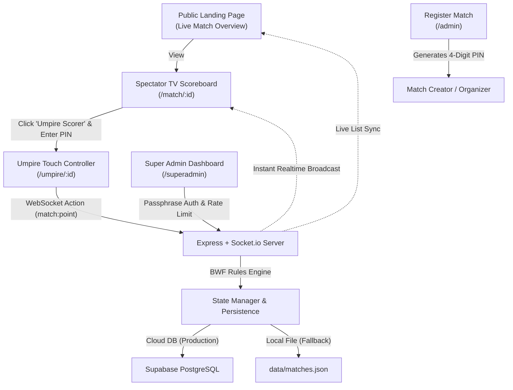

# 🏸 ShuttleLive — Real-Time Badminton Arena Scoreboard

> **Instant, frictionless, stadium-grade live badminton scoreboard for clubs, tournament organizers, and court-side TVs.**  
> Completely free, zero account registration required. Powered by auto-generated 4-digit PINs, Supabase cloud persistence, and real-time WebSockets.

[](https://akuumpire.onrender.com/)
[](LICENSE)
[](package.json)
[](https://supabase.com)

👉 **Experience the Live Stadium Demo:** [**https://akuumpire.onrender.com/**](https://akuumpire.onrender.com/)  
*(Tip: Open the link on your laptop as the TV scoreboard and on your phone as the Umpire Controller to watch scores sync instantly with < 50ms latency!)*

---

## 🌟 Key Features

- **⚡ Zero Account Registration**: Anyone can create a match in 10 seconds. No email, password, or credit card required.
- **🔒 PIN & Token Security**: Auto-generates a secure 4-digit PIN (e.g. `8392`) so only authorized umpires on the court can update scores.
- **🛡️ Hardened Super Admin Console**: Multi-court stadium management dashboard protected by arbitrary-length passphrases, SHA-256 timing-safe verification, IP-based brute-force lockout (5 attempts -> 15 min ban), and stateless session tokens.
- **☁️ Supabase Cloud Persistence**: Built-in cloud database integration using PostgreSQL JSONB, ensuring matches survive server restarts, scale-to-zero sleeps, and redeployments permanently on free cloud hosts like Render. Auto-falls back to local JSON for offline development.
- **📺 BWF Stadium TV Scoreboard**: High-contrast, dark-mode display with digital LED scores, pulsing serve indicators, set histories, and full-screen TV mode for gym monitors with zero layout shifts on status alerts.
- **🎬 Interactive Match Replay Engine**: Replay any concluded match rally-by-rally from 0-0 with play/pause, scrub speed controls (1x, 2x, 4x), and step-by-step navigation.
- **📱 Ergonomic Umpire Controller**: Massive thumb-friendly touch pads (`+1`), instant undo button, tactile audio feedback, and visual service box guidance.
- **🔄 Real-Time WebSockets**: Instant updates (< 50ms) across all devices and TVs via Socket.io.
- **📲 QR Code Sharing**: Spectators in the stands can scan the scoreboard QR code to follow the game live on their own phones.
- **🏸 Official BWF Rule Engine**: Automated interval breaks (11 pts), deuce detection (20-20), sudden-death golden points (up to 30), and doubles court service rotations.

---

## 🏛️ System Architecture



---

## 🚀 Quick Start

> **Want to test immediately without cloning or installing?**  
> Jump straight to the live hosted demo at **[https://akuumpire.onrender.com/](https://akuumpire.onrender.com/)**.

### Prerequisites
- Node.js 18.x or newer
- npm 9.x or newer

### Installation

```bash
# 1. Clone repository
git clone https://github.com/your-username/shuttlelive.git
cd shuttlelive

# 2. Install dependencies
npm install

# 3. Start development server
npm run dev
```

Visit **`http://localhost:3000`** in your browser!

---

## 🎮 How to Use

1. **View Ongoing Games**: Open the landing page (`/`) to see live matches across all courts.
2. **Create a Match**: Click **"+ Register Match"** (or visit `/admin`). Select your venue, court number, player names, and scoring format.
3. **Control Scores as Umpire**:
   - The creator is automatically authorized on their device.
   - Anyone else can click **"Umpire"** on the match screen, type the match's **4-digit PIN**, and tap points directly from their phone!
4. **Project to TV**: Open the match on any smart TV or monitor and click **"⛶ TV Mode"**.

---

## 🧪 Testing

The BWF scoring engine includes automated unit tests verifying:
- Game point / Match point calculations
- Deuce rules and 30-point golden point caps
- Singles & Doubles court rotations
- 11-point interval breaks
- Multi-step undo functionality

Run the tests anytime:
```bash
npm test
```

---

## 🔄 CI/CD & GitHub Workflow Guide

ShuttleLive includes a production-grade **GitHub Actions CI pipeline** (`.github/workflows/ci.yml`) that automatically validates all scoring, rotation, and replay logic across multiple Node.js environments.

### 1. Pushing Code to `master` (Automatic CI)
You do **not** need any tag to trigger CI. Any normal push to `master` triggers the test suite automatically:

```bash
git add .
git commit -m "feat: your new feature"
git push origin master
```

**What happens:**
1. GitHub detects the push to `master`.
2. Spins up 3 parallel virtual machines testing on **Node 18.x, 20.x, and 22.x**.
3. Installs clean dependencies via `npm ci` and executes all unit tests (`npm test`).
4. If all tests pass, your commit receives a green verified checkmark (**✔**).

### 2. Creating Version Tags / Releases
When releasing a new milestone or major version, you can tag your commits using Semantic Versioning (`v1.0.0`, `v1.1.0`):

```bash
# Create an annotated tag
git tag -a v1.0.0 -m "Release v1.0.0: Live scoreboard, umpire touch controller, and match replay"

# Push the tag to GitHub
git push origin v1.0.0

# Or push code and all tags simultaneously:
git push origin master --tags
```

**What happens:**
- The CI pipeline runs on tag `v*` to certify the release build.
- GitHub automatically creates a release milestone under your repository's **Releases** tab.

### 3. Monitoring Test Runs
Visit your repository on GitHub and click the **Actions** tab (`https://github.com/<owner>/<repo>/actions`) to see real-time execution logs for every commit and tag.

---

## 🔐 Environment Variables

Copy `.env.example` to `.env` to configure your environment:

```bash
cp .env.example .env
```

| Variable | Required | Default | Description |
| :--- | :---: | :---: | :--- |
| `PORT` | Optional | `3000` | Port for the web & WebSocket server. Automatically supplied on cloud platforms like Render. |
| `HOST` | Optional | `0.0.0.0` | Network binding interface. |
| `SUPERADMIN_PASSWORD` | Optional | `9999` | Master passphrase for `/superadmin`. Supports arbitrary-length passphrases. Also accepts `SUPERADMIN_KEY`. |
| `SUPABASE_URL` | Optional | *none* | Your Supabase project URL (e.g. `https://xyz.supabase.co`). Enables cloud persistence. |
| `SUPABASE_KEY` | Optional | *none* | Your Supabase project `service_role` (secret) or `anon` (public) API key. |

> **Note**: If `SUPABASE_URL` and `SUPABASE_KEY` are not set, the server automatically defaults to local JSON storage (`data/matches.json`).

---

## ☁️ Database & Persistence (Supabase vs Local JSON)

ShuttleLive features an automatic **hybrid storage engine**:
- **On Cloud Hosts (Render, Railway, Fly.io)**: Ephemeral server instances wipe local disks on rebuilds and sleep cycles. Setting `SUPABASE_URL` and `SUPABASE_KEY` persists all matches, scores, and replay timelines permanently to free cloud PostgreSQL ($0 cost).
- **On Local Development / Offline**: Works out of the box with zero database installation required, writing directly to `data/matches.json`.

### Supabase Table Schema
When connecting a new Supabase project, execute this migration in your Supabase **SQL Editor**:

```sql
CREATE TABLE IF NOT EXISTS matches (
  id TEXT PRIMARY KEY,
  admin_pin TEXT NOT NULL,
  admin_token TEXT NOT NULL,
  created_at TIMESTAMPTZ NOT NULL DEFAULT NOW(),
  updated_at TIMESTAMPTZ NOT NULL DEFAULT NOW(),
  match_state JSONB NOT NULL
);

CREATE INDEX IF NOT EXISTS idx_matches_updated_at ON matches (updated_at DESC);
```

---

## 🛡️ Super Admin Dashboard (`/superadmin`)

Tournament organizers and stadium managers can access the central command board at `/superadmin`:
- **Real-Time Court Monitoring**: View all active, finished, and abandoned courts with idle timers.
- **PIN Recovery & Admin Launch**: View court umpire PINs or directly launch the umpire console without entering PINs.
- **Court Lifecycle Actions**: Remote conclusion, abandonment, or hard deletion of stuck courts.
- **Bulk Cleanup**: Purge concluded matches or restore default tournament demo matches with 1 click.
- **Brute-Force Protection**: 5 failed login attempts lock out the client IP for 15 minutes with HTTP 429 status.
- **Timing-Safe Auth**: Protected against side-channel timing analysis attacks using Node's `crypto.timingSafeEqual`.

---

## 📦 Project Structure

```
shuttlelive/
├── .github/
│   └── workflows/
│       └── ci.yml               # Automated CI test runner (Node 18, 20, 22)
├── data/
│   └── matches.json             # Local fallback JSON match store
├── server/
│   ├── server.js                # Express & Socket.io server + Super Admin API
│   ├── rules/
│   │   └── badmintonRules.js    # BWF scoring, deuce, rotation & interval engine
│   └── models/
│       └── matchStore.js        # Hybrid memory, Supabase & disk persistence store
├── public/
│   ├── index.html               # Live courts stadium lobby
│   ├── admin.html               # Match registration & PIN creator
│   ├── match.html               # Spectator & TV stadium scoreboard + replay
│   ├── umpire.html              # Mobile touch scoring console
│   ├── superadmin.html          # Tournament master management console
│   ├── css/
│   │   ├── tokens.css           # Visual theme tokens & palette
│   │   ├── base.css             # Base components, modals & layout
│   │   ├── scoreboard.css       # LED digital scoreboard & broadcast ribbon
│   │   └── umpire.css           # Ergonomic touch controller styles
│   └── js/
│       ├── socket.js            # Socket.io connection & WebAudio sound synthesis
│       ├── home.js              # Landing page controller
│       ├── admin.js             # Match registration controller
│       ├── match.js             # Spectator scoreboard controller
│       ├── umpire.js            # Umpire scoring controller
│       ├── superadmin.js        # Super Admin management controller
│       └── replayEngine.js      # Frame generator & timeline simulation engine
├── tests/
│   └── badmintonRules.test.js   # Automated unit tests (15 test suites)
├── .env.example                 # Environment configuration template
├── CONTRIBUTING.md               # Contribution guidelines
├── LICENSE                       # MIT License
└── package.json
```

---

## 🌐 Deployment Options

### Deploying to Render.com (Recommended Free Setup)

1. **Connect GitHub Repo**: Link your repository in the Render Dashboard.
2. **Create Web Service**:
   - **Environment**: `Node`
   - **Build Command**: `npm install`
   - **Start Command**: `npm start`
3. **Configure Environment Variables**:
   Under the **Environment** tab of your Render service, add:
   - `SUPERADMIN_PASSWORD`: Your secret super admin passphrase
   - `SUPABASE_URL`: `https://<your-project-ref>.supabase.co`
   - `SUPABASE_KEY`: Your Supabase `service_role` (secret) API key
4. **Deploy**: Render will build the service and deploy it with permanent cloud database persistence.

---

## 📄 License

This project is licensed under the [MIT License](LICENSE).
