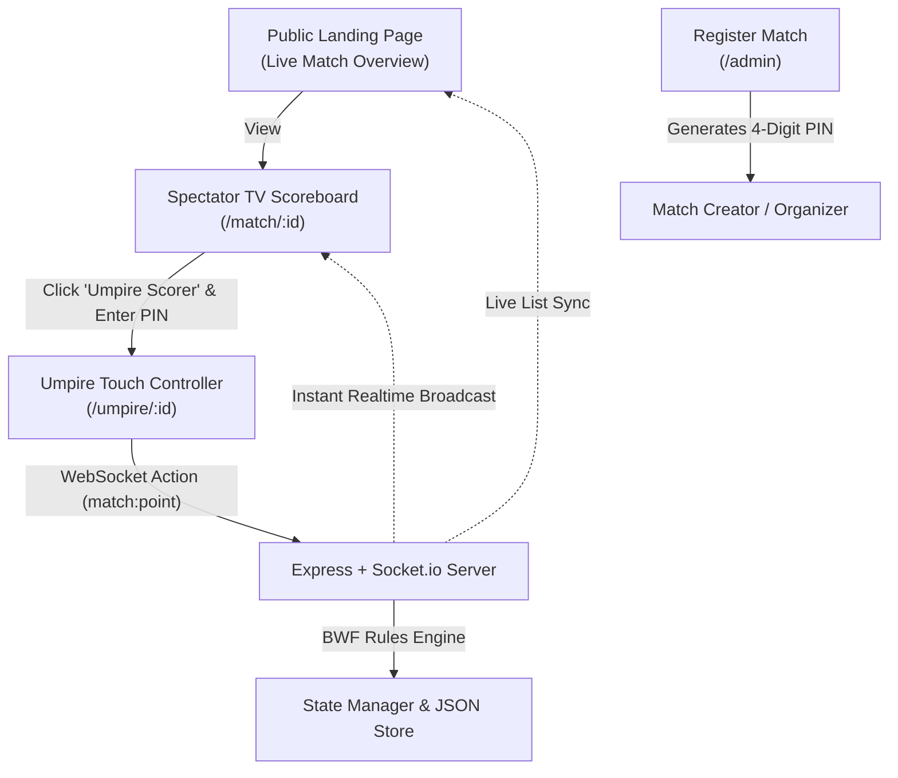

# 🏸 ShuttleLive — Real-Time Badminton Arena Scoreboard

> **Instant, frictionless, stadium-grade live badminton scoreboard for clubs, tournament organizers, and court-side TVs.**  
> Completely free, zero account registration required. Powered by auto-generated 4-digit PINs and real-time WebSockets.

---

## 🌟 Key Features

- **⚡ Zero Account Registration**: Anyone can create a match in 10 seconds. No email, password, or credit card required.
- **🔒 PIN & Token Security**: Auto-generates a secure 4-digit PIN (e.g. `8392`) so only authorized umpires on the court can update scores.
- **📺 BWF Stadium TV Scoreboard**: High-contrast, dark-mode display with digital LED scores, pulsing serve indicators, set histories, and full-screen TV mode for gym monitors.
- **📱 Ergonomic Umpire Controller**: Massive thumb-friendly touch pads (`+1`), instant undo button, tactile audio feedback, and visual service box guidance.
- **🔄 Real-Time WebSockets**: Instant updates (< 50ms) across all devices and TVs via Socket.io.
- **📲 QR Code Sharing**: Spectators in the stands can scan the scoreboard QR code to follow the game live on their own phones.
- **🏸 Official BWF Rule Engine**: Automated interval breaks (11 pts), deuce detection (20-20), sudden-death golden points (up to 30), and doubles court service rotations.

---

## 🏛️ System Architecture



---

## 🚀 Quick Start

### Prerequisites
- Node.js 18.x or newer
- npm 9.x or newer

### Installation

```bash
# 1. Clone repository
git clone https://github.com/your-username/shuttlelive.git
cd shuttlelive

# 2. Install dependencies
npm install

# 3. Start development server
npm run dev
```

Visit **`http://localhost:3000`** in your browser!

---

## 🎮 How to Use

1. **View Ongoing Games**: Open the landing page (`/`) to see live matches across all courts.
2. **Create a Match**: Click **"+ Register Match"** (or visit `/admin`). Select your venue, court number, player names, and scoring format.
3. **Control Scores as Umpire**:
   - The creator is automatically authorized on their device.
   - Anyone else can click **"Umpire"** on the match screen, type the match's **4-digit PIN**, and tap points directly from their phone!
4. **Project to TV**: Open the match on any smart TV or monitor and click **"⛶ TV Mode"**.

---

## 🧪 Testing

The BWF scoring engine includes automated unit tests verifying:
- Game point / Match point calculations
- Deuce rules and 30-point golden point caps
- Singles & Doubles court rotations
- 11-point interval breaks
- Multi-step undo functionality

Run the tests anytime:
```bash
npm test
```

---

## 🔄 CI/CD & GitHub Workflow Guide

ShuttleLive includes a production-grade **GitHub Actions CI pipeline** (`.github/workflows/ci.yml`) that automatically validates all scoring, rotation, and replay logic across multiple Node.js environments.

### 1. Pushing Code to `master` (Automatic CI)
You do **not** need any tag to trigger CI. Any normal push to `master` triggers the test suite automatically:

```bash
git add .
git commit -m "feat: your new feature"
git push origin master
```

**What happens:**
1. GitHub detects the push to `master`.
2. Spins up 3 parallel virtual machines testing on **Node 18.x, 20.x, and 22.x**.
3. Installs clean dependencies via `npm ci` and executes all unit tests (`npm test`).
4. If all tests pass, your commit receives a green verified checkmark (**✔**).

### 2. Creating Version Tags / Releases
When releasing a new milestone or major version, you can tag your commits using Semantic Versioning (`v1.0.0`, `v1.1.0`):

```bash
# Create an annotated tag
git tag -a v1.0.0 -m "Release v1.0.0: Live scoreboard, umpire touch controller, and match replay"

# Push the tag to GitHub
git push origin v1.0.0

# Or push code and all tags simultaneously:
git push origin master --tags
```

**What happens:**
- The CI pipeline runs on tag `v*` to certify the release build.
- GitHub automatically creates a release milestone under your repository's **Releases** tab.

### 3. Monitoring Test Runs
Visit your repository on GitHub and click the **Actions** tab (`https://github.com/<owner>/<repo>/actions`) to see real-time execution logs for every commit and tag.

---

## 📦 Project Structure

```
shuttlelive/
├── .github/
│   └── workflows/
│       └── ci.yml               # Automated CI test runner
├── data/
│   └── matches.json             # Persistent match records
├── server/
│   ├── server.js                # Express & Socket.io server
│   ├── rules/
│   │   └── badmintonRules.js    # BWF scoring & rotation engine
│   └── models/
│       └── matchStore.js        # Match memory & disk persistence
├── public/
│   ├── index.html               # Live courts landing page
│   ├── admin.html               # Match registration & PIN creator
│   ├── match.html               # Spectator & TV stadium scoreboard
│   ├── umpire.html              # Mobile touch scoring console
│   ├── css/
│   │   ├── tokens.css           # Visual theme tokens & palette
│   │   ├── base.css             # Base components, modals & layout
│   │   ├── scoreboard.css       # LED digital scoreboard styles
│   │   └── umpire.css           # Ergonomic controller styles
│   └── js/
│       ├── socket.js            # Socket.io connection & WebAudio
│       ├── home.js              # Landing page controller
│       ├── admin.js             # Match registration controller
│       ├── match.js             # Spectator scoreboard controller
│       └── umpire.js            # Umpire scoring controller
├── tests/
│   └── badmintonRules.test.js   # Automated unit tests
├── CONTRIBUTING.md               # Contribution guidelines
├── LICENSE                       # MIT License
└── package.json
```

---

## 🌐 Deployment Options

### Render / Railway / Fly.io (Zero Config)
- **Build Command**: `npm install`
- **Start Command**: `npm start`
- **Environment**: Set `PORT=3000` (or leave default assigned by host).

---

## 📄 License

This project is licensed under the [MIT License](LICENSE).
